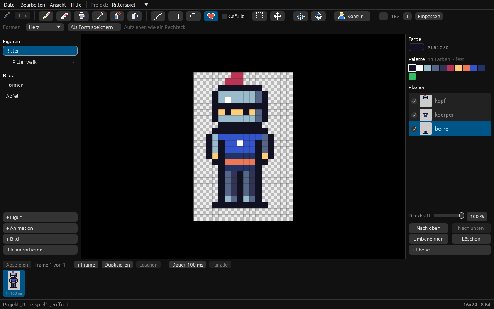
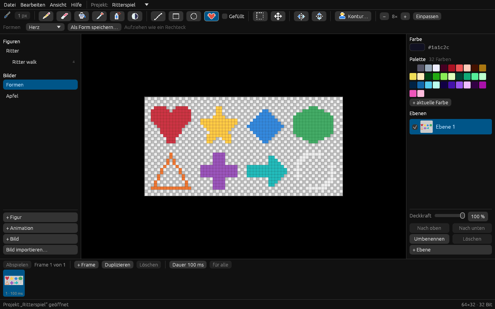
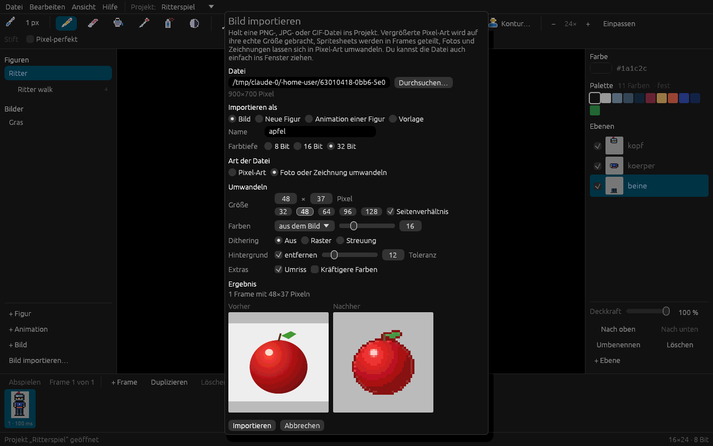
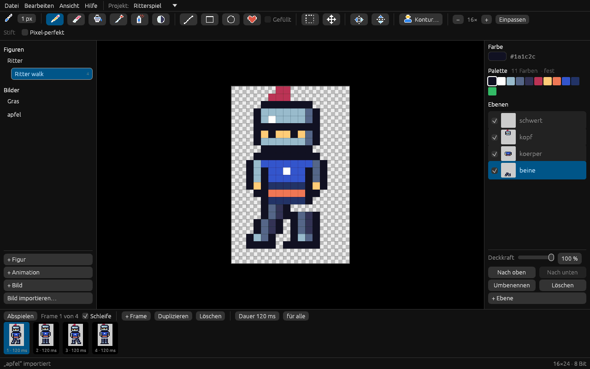
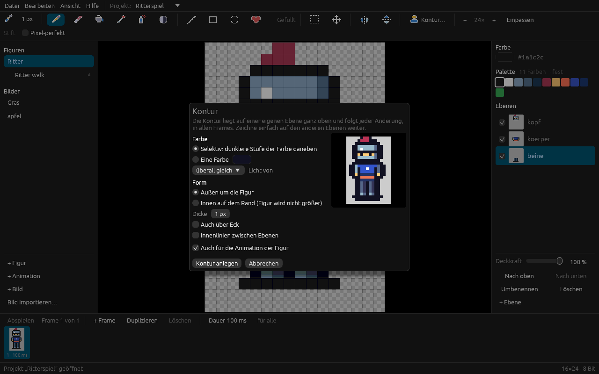
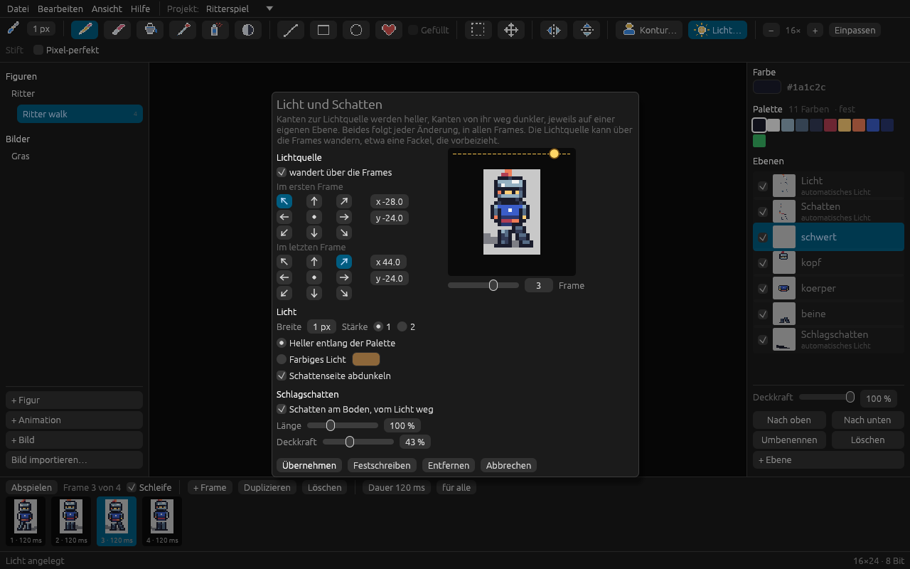
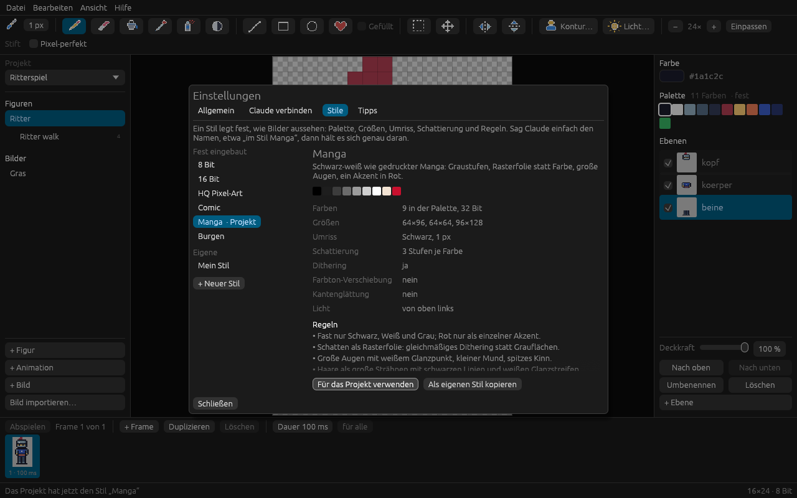
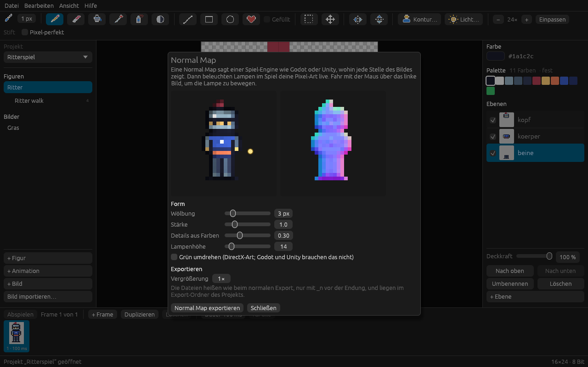
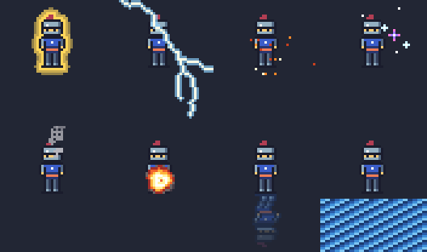

# PixelArt Studio

Ein eigenständiges Pixel-Art-Studio für Windows, geschrieben in Rust. Du zeichnest selbst, und
Claude (oder eine andere KI) zeichnet über MCP im selben Projekt mit.

**[Download für Windows](https://github.com/Seralex666/PixelART_MCP/releases/latest)** ·
[Was ist neu](CHANGELOG.md) · [Mit Claude verbinden](docs/MCP-EINRICHTUNG.md)



## Was das Studio kann

### Zeichnen wie in einem richtigen Pixel-Editor

Stift (auf Wunsch pixel-perfekt), Radierer, Füllen, Pipette, Sprühdose, Aufhellen und Abdunkeln entlang
der Palette, Linie, Rechteck, Ellipse und Formen wie Herz, Stern, Raute oder Pfeil. Was du selbst zeichnest,
speicherst du als eigene Form und hast es in jedem Projekt. Dazu Auswahl mit Kopieren und Einfügen,
Spiegeln beim Zeichnen, Ebenen mit Deckkraft und Rückgängig für alles.



### Fotos und Zeichnungen in Pixel-Art umwandeln

Ein Foto, ein Scan oder ein gemaltes Bild wird zu echter Pixel-Art: Zielgröße wählen, Farbanzahl oder die
Palette des Projekts, auf Wunsch Dithering, Hintergrund entfernen und Umriss. Die Vorschau zeigt vorher und
nachher nebeneinander. Oder du legst das Bild als halb durchsichtige **Vorlage** unter deine Zeichnung und
zeichnest es selbst nach; die Vorlage landet nie im Export.



### Figuren und Animationen, die zusammenpassen

Eine Figur hat eine feste Palette und eine Grundpose. Animationen wie Laufen, Springen oder Angriff
entstehen aus ihr, Frame für Frame mit Zwiebelhaut, und werden gegen die Figur geprüft. Export als PNG,
Spritesheet mit JSON, animiertes GIF oder WebM.



### Automatische Kontur

Ein Umriss um Figuren, der jeder Änderung folgt, in allen Frames. Wahlweise in einer festen Farbe oder als
dunklere Stufe der Farbe daneben, auf Wunsch mit Lichtrichtung.



### Licht und Schatten, auch in Animationen

Eine Lichtquelle macht die Kanten zu ihr heller und die abgewandten dunkler, jeweils auf einer eigenen
Ebene. Sie kann über die Frames wandern, etwa eine Fackel, die vorbeizieht, und wirft auf Wunsch einen
Schatten auf den Boden, der vom Licht wegfällt. Wie die Kontur folgt alles jeder Änderung.



### Stile: Manga, Comic, 8 Bit und eigene

Eine Stil-Bibliothek mit Comic, Manga, Burgen, 8 Bit, 16 Bit und HQ Pixel-Art. Jeder Stil legt Palette,
Farbtiefe, Größen, Umriss, Schattierung und Regeln fest. Sag Claude einfach „im Stil Manga“, dann hält es sich
genau daran. Eigene Stile legst du in den Einstellungen an, sie gelten in allen Projekten.



### Normal Maps für Licht im Spiel

Aus jedem Bild und jeder Animation entsteht auf Knopfdruck eine Normal Map, mit der Godot oder Unity deine
Pixel-Art live beleuchten. In der Vorschau folgt eine Lampe der Maus.



### Effekte und Farbzyklen

Leuchten, Blitz, Explosion, Spiegelung im Wasser, Funken, Rauch, Magie und Farbzyklen für fließendes Wasser,
Feuer und Lava. Jeder Effekt liegt auf einer eigenen Ebene, läuft als Schleife über die Frames und folgt jeder
Änderung an der Figur. Aus einem Standbild wird dabei auf Wunsch gleich eine Animation.



### Claude zeichnet mit

Das Studio ist zugleich ein MCP-Server mit 28 Werkzeugen. Claude legt Figuren an, zeichnet mit Formen,
Verläufen, Licht und Schatten, wandelt Fotos um und prüft das Ergebnis, alles in denselben Projektdateien,
die du im Editor offen hast. Der Editor zeigt Claudes Änderungen nach kurzer Zeit, und Rückgängig nimmt sie
auch wieder zurück. Einrichten: **Datei › Einstellungen › Claude verbinden** im Editor.

## Ziele

- **Echte Pixel:** Jedes Bild ist ein Raster aus einzelnen Pixeln, bis 1024×1024. Keine Glättung, keine Skalierungstricks.
- **Farbtiefe:** 8 Bit (Palette mit bis zu 256 Farben), 16 Bit (RGB565) oder 32 Bit (RGBA).
- **Konstanz:** Figuren sind feste Assets mit gesperrter Palette. Animationen (Idle, Walk, Run, Jump, Attack, Hurt, Death) werden aus der Figur abgeleitet und gegen sie geprüft.
- **Export:** PNG (auch mit Palette), JPG, Spritesheets mit JSON-Metadaten, animierte GIFs und WebM-Videos.
- **Import:** Vorhandene PNG-, JPG- und GIF-Dateien werden zu Bildern, Figuren oder Animationen, auch aus Spritesheets. Fotos und Zeichnungen werden auf Wunsch zu Pixel-Art.
- **MCP:** Claude zeichnet in denselben Projektdateien, die du im Editor öffnest.

## Stand

| Schritt | Inhalt | Status |
|---|---|---|
| 1 | `pixel-core`: Datenmodell, Zeichenwerkzeuge, Projektformat, PNG/JPG/Sheet-Export | fertig |
| 2 | `pixel-mcp`: MCP-Server mit 28 Werkzeugen für Claude und andere MCP-Clients | fertig |
| 3 | `pixel-editor`: Editor mit Leinwand, Werkzeugen, Ebenen, Timeline, Export und Live-Abgleich mit Claude | fertig |
| 4 | GIF- und WebM-Export, indizierte PNGs | fertig |
| 5 | Import von PNG, JPG, GIF und Spritesheets im Editor und über MCP | fertig |
| 6 | Pixel-Art-Techniken für Claude: Kontur, Licht, Raster, Verlauf, Körnung, Formel, Stempel, mehrere Frames je Aufruf | fertig |
| 7 | Prüf-Hinweise, Paletten aus Bildern, Farbreduktion, Projekt-Stil | fertig |
| 8 | Einstellungen (Speicherordner, Sprache Deutsch/Englisch), Werkzeug-Symbole | fertig |
| 9 | Automatische Konturen, Projekte löschen, aufgeräumte Seitenleisten, Programmsymbol | fertig |
| 10 | Formen und eigene Formen, Sprühdose, Aufhellen/Abdunkeln, Auswahl, Spiegeln, Pixel-perfekt, Farbe ersetzen, Leinwandgröße, Paletten mit 32 und 64 Farben | fertig |
| 1.0 Beta | Fotos und Zeichnungen in Pixel-Art umwandeln, Vorlage-Ebene zum Nachzeichnen, Feature-Übersicht | fertig |
| 1.1 | Licht und Schatten, die über die Frames wandern, Schlagschatten am Boden | fertig |
| 1.2 | Stil-Bibliothek (Comic, Manga, Burgen, 8 Bit, 16 Bit, HQ) und eigene Stile, Einstellungen mit Tabs, Normal Maps | fertig |
| 1.3 | Effekte (Leuchten, Blitz, Explosion, Spiegelung, Funken, Rauch, Magie) und Farbzyklen | fertig |

## Aufbau

```
crates/
  pixel-core/   Gemeinsamer Kern für Editor und MCP-Server
  pixel-mcp/    MCP-Server, als Bibliothek im Editor eingebaut und als eigenes Programm `pixelart-mcp`
  pixel-editor/ Editor (Programm `pixelart-studio`), mit `--mcp` zugleich der MCP-Server
docs/
  MCP-EINRICHTUNG.md   So verbindest du Claude mit dem Studio
```

Wichtige Typen in `pixel-core`:

- `Sprite`: Pixelbild mit Ebenen und Frames, erzwingt die Farbtiefe beim Schreiben.
- `Character`: Figur mit Grundpose, gesperrter Palette und Ankerpunkt.
- `Animation`: gehört zu einer Figur, jeder Frame startet als Kopie der Grundpose.
- `Project`: Figuren, Animationen, freie Bilder und Paletten in einer `.pxproj`-Datei. `validate()` meldet jede Abweichung einer Animation von ihrer Figur.
- `CharacterBundle`: einzelne Figur als `.pxchar`-Datei, um sie unverändert in andere Projekte zu übernehmen.

## Der Editor

`pixelart-studio` ist das Programm zum Selberzeichnen:

- Leinwand mit pixelgenauer Vergrößerung, Raster und Zwiebelhaut (vorheriger Frame scheint durch)
- Werkzeuge mit eigenem Pixel-Symbol: Stift (auf Wunsch pixel-perfekt), Radierer, Füllen, Pipette, Sprühdose,
  Aufhellen/Abdunkeln entlang der Farbtreppen der Palette, Linie, Rechteck, Ellipse, Formen, Auswahl und
  Ebene verschieben; vorn die Pinselgröße in px, darunter die Einstellungen des gewählten Werkzeugs
- **Formen:** Herz, Raute, Stern, Dreieck, Kreuz, Sechseck, Pfeil und Kreis, gefüllt oder als Umriss, in jeder
  Größe aufgezogen. **Als Form speichern…** macht Gezeichnetes (die Auswahl oder eine Ebene) zu einer eigenen
  Form; sie liegt als PNG im Speicherordner unter `shapes` und steht in allen Projekten bereit
- **Auswahl:** Bereich aufziehen, verschieben, kopieren, ausschneiden, einfügen (auch Bilder aus der
  Zwischenablage), spiegeln und leeren; Strg+A, Strg+C, Strg+X, Strg+V, Entf, Esc
- **Spiegeln beim Zeichnen** links-rechts und oben-unten, die Achsen sind auf der Leinwand zu sehen
- **Farbe ersetzen…** im aktuellen oder in allen Frames, auf einer oder allen Ebenen; **Leinwandgröße…**
  mit Ausrichtung oder auf den Inhalt zugeschnitten (eine Figur ändert sich mit allen Animationen)
- Neue Figuren und Bilder mit Farbtreppen aus 32 oder 64 Farben, der Palette des Projekts oder den Farben eines Bildes
- Oberfläche auf Deutsch oder Englisch (Datei › Einstellungen)
- Palette, Ebenen mit Vorschaubild, Deckkraft und Reihenfolge, Timeline mit Vorschaubildern und Animationsvorschau
- Automatische Kontur (Kontur…), siehe unten
- Projekte löschen: Datei › Projekt löschen… oder Rechtsklick in der Projektliste
- Neue Figuren, Animationen und Bilder aus Vorlagen; Export als PNG, JPG, Spritesheet, GIF oder WebM
- Bilder importieren (Strg+I oder Datei ins Fenster ziehen), Fotos in Pixel-Art umwandeln oder als Vorlage
  zum Nachzeichnen einfügen, siehe unten
- Gespeichert wird nach jeder Änderung von selbst, Rückgängig mit Strg+Z

Editor und MCP-Server arbeiten im selben Arbeitsordner. Zeichnet Claude, lädt der Editor das Projekt
nach kurzer Zeit neu; „Rückgängig“ nimmt auch Claudes letzte Änderung am geöffneten Bild zurück.

Der Arbeitsordner ist, in dieser Reihenfolge: `--home <Ordner>`, die Umgebungsvariable `PIXELART_HOME`,
der Speicherordner aus **Datei › Einstellungen**, ein Ordner `Projekte` neben dem Programm, sonst
`Dokumente/PixelArt Studio`.

In den Einstellungen wählst du auch die Sprache. Sie gilt sofort für das ganze Programm; Claude bekommt
seine Werkzeuge immer auf Englisch. Gespeichert werden die Einstellungen in
`%APPDATA%\PixelArt Studio\settings.json` (unter Linux `~/.config/PixelArt Studio/settings.json`,
abweichend über die Umgebungsvariable `PIXELART_SETTINGS`).

## Zeichentechniken für Claude

Das Werkzeug `draw` kennt neben Pixeln, Linien, Flächen und dem Textraster auch Techniken, die sonst viele
einzelne Aufrufe oder ein Skript bräuchten. Alle arbeiten pixelgenau, ohne Glättung, und halten sich an
gesperrte Paletten.

| Op | Wirkung |
|---|---|
| `outline` | Kontur um alles, was auf der Ebene gezeichnet ist |
| `shade` | Licht und Schatten aus einer Richtung, mit einer Farbreihe von dunkel nach hell |
| `gradient` | Verlauf in harten Stufen, gerade oder rund, auf Wunsch gerastert |
| `dither` | Rasterübergang zwischen zwei Farben (Bayer-Muster oder Schachbrett) |
| `noise` | Körnung mit festem Startwert, also jedes Mal dasselbe Bild |
| `shader` | Formel je Pixel mit `x`, `y`, `frame`, `dist()`, `noise()`, `rand()`: für Glut, Licht und Muster |
| `stamp` | Ein Stück kopieren und einfügen, auch gespiegelt, gedreht, umgefärbt oder aus einem anderen Asset |
| `shape` | Herz, Raute, Stern, Dreieck, Kreuz, Sechseck, Pfeil, Kreis oder eine eigene Form in jeder Größe |
| `spray` | Sprühdose: zufällig gestreute Pixel in einem Kreis, mit Dichte und festem Startwert |
| `lighten`, `darken` | Gezeichnetes eine Stufe heller oder dunkler, entlang der Farbtreppen der Palette |
| `move_area`, `flip_area`, `clear_area` | Einen Ausschnitt verschieben, spiegeln oder leeren |

Die Flächen-Ops nehmen einen Ausschnitt (`x`, `y`, `w`, `h`) und eine Maske (`mask`: alles, nur Gezeichnetes,
nur Leeres oder nur eine bestimmte Farbe). Die Formel von `shader` kann nur rechnen: Es gibt keine Schleifen,
keinen Zugriff auf Dateien und keinen fremden Code, und ihre Länge ist begrenzt.

Ein Aufruf kann mehrere Frames auf einmal zeichnen (`frame`: Zahl, Liste oder `"all"`). `per_frame` legt fest,
was sich von Frame zu Frame ändert: andere Farben oder zusätzliche Ops wie eine Verschiebung. `undo` nimmt die
letzten Zeichen-Aufrufe zurück, solange das Bild inzwischen nicht anders geändert wurde. `view` zeigt auf Wunsch
ein Pixelraster mit Koordinaten, einen Ausschnitt oder die Kachel 3×3 nebeneinander. Mit `mirror` wird jeder
Aufruf spiegelsymmetrisch. Eigene Formen verwaltet Claude mit `custom_shapes`, die Leinwand ändert
`resize_canvas`, und `edit_layers` verschiebt Ebenen nach oben oder unten.

## Automatische Kontur

Über **Kontur…** (oben in der Werkzeugleiste, im Menü Bearbeiten oder per Rechtsklick auf ein Asset) bekommt ein Bild,
eine Animation oder eine Figur samt allen Animationen eine Kontur auf einer eigenen Ebene ganz oben. Sie entsteht
aus allen anderen sichtbaren Ebenen und wird nach jeder Änderung in allen Frames neu gezeichnet, egal ob du
zeichnest oder Claude. Claude benutzt dafür `set_outline`. Die Kontur ist freiwillig; ohne sie ändert sich nichts.

- **Selektiv** (jeder Konturpixel ist eine dunklere Stufe der Farbe daneben, auf der Lichtseite heller) oder
  **eine Farbe**. Bei Figuren kommen die Farben immer aus ihrer Palette.
- **Außen** um die Figur oder **innen** auf ihrem Rand, dann wird sie nicht größer; Dicke 1 bis 4 Pixel.
- **Über Eck** schließt diagonale Lücken, **Innenlinien** trennen Ebenen, etwa einen Arm vor dem Körper.
- **Festschreiben** macht aus der Kontur eine normale Ebene zum Nachbessern, **Entfernen** löscht sie.
  Neue Animationen einer Figur übernehmen ihre Kontur.

## Normal Maps

Über **Datei › Normal Map…** (oder Rechtsklick auf ein Asset) entsteht aus jedem Frame eine Normal Map. Die Form
kommt aus dem Rand der Figur (Wölbung und Stärke einstellbar), auf Wunsch tragen helle und dunkle Farben Details bei.
Die Vorschau beleuchtet das Bild mit einer Lampe, die der Maus folgt. Exportiert wird als PNG je Frame oder als
Spritesheet, mit demselben Namen wie das Farbbild und `_n` vor der Endung, in OpenGL-Art (wie Godot und Unity sie
erwarten; DirectX-Art auf Wunsch). Claude benutzt dafür `export` mit `normal_map`.

## Effekte

Über **Effekte…** (Werkzeugleiste, Menü Bearbeiten oder Rechtsklick auf ein Asset) bekommt ein Bild, eine
Animation oder eine Figur Effekte, bis zu acht Stück. Claude benutzt dafür `effects`. Jeder Effekt liegt auf einer
eigenen Ebene und wird nach jeder Änderung in allen Frames neu gezeichnet; die Vorschau im Dialog spielt ihn ab.
Wiederkehrende Effekte laufen nahtlos im Kreis. **Frames mindestens** macht aus einem Standbild eine Schleife,
indem die vorhandenen Frames kopiert werden.

- **Leuchten:** ein pulsierender Schein hinter der Figur, oder nur um ausgewählte Farben (Augen, Klinge, Laterne).
- **Blitz:** gezackt, mit Ästen und Schein, in jedem Frame neu geformt und auf Wunsch flackernd. Klick in die
  Vorschau setzt den Anfang, Rechtsklick das Ende.
- **Explosion:** Blitz, Feuerball, Trümmer und Rauch, einmal ablaufend ab einem Frame.
- **Spiegelung:** das Spiegelbild im Wasser unter der Figur, getönt, nach unten schwächer und mit Wellen. Bei
  einem Bild wächst die Leinwand auf Wunsch nach unten, bis alles passt.
- **Funken, Rauch und Magie:** Partikel aus einer Quelle, die man in die Vorschau klickt.
- **Farbzyklus:** Pixel einer Farbreihe wandern Schritt für Schritt zur nächsten Farbe. Mit den Vorlagen Wasser,
  Feuer und Lava malen, dann fließt die Fläche.
- **Festschreiben** macht aus dem Effekt eine normale Ebene, **Entfernen** löscht ihn. Bei 8 und 16 Bit und
  bei festen Paletten wird gerastert statt durchscheinend gezeichnet.

## Licht und Schatten

Über **Licht…** (Werkzeugleiste, Menü Bearbeiten oder Rechtsklick auf ein Asset) bekommt ein Bild, eine
Animation oder eine Figur automatisches Licht. Claude benutzt dafür `set_light`. Es entsteht aus den sichtbaren
Ebenen und wird nach jeder Änderung in allen Frames neu gezeichnet.

- **Lichtquelle:** eine Richtung (die Pfeile setzen sie weit außerhalb des Bildes) oder ein Punkt mit x und y,
  auch mitten im Bild. **Wandert über die Frames** verteilt sie gleichmäßig von einer Position im ersten Frame
  zu einer im letzten; Claude kann auch einen Pfad mit mehreren Punkten angeben.
- **Licht:** Breite 1 bis 4 Pixel, Stärke 1 oder 2, heller entlang der Palette oder farbiges Licht.
  Dunkle Umrisspixel bleiben unangetastet.
- **Schattenseite abdunkeln** legt die abgewandten Kanten auf eine eigene Schatten-Ebene.
- **Schlagschatten:** ein flacher Schatten am Boden, der vom Licht weg fällt, mit Länge und Deckkraft. Er liegt
  ganz unten und bekommt keine Kontur.
- **Festschreiben** macht aus den Ebenen normale Ebenen, **Entfernen** löscht sie. Licht und Kontur
  vertragen sich: Die Kontur liegt immer ganz oben.

## Stil, Paletten und Prüf-Hinweise

- **Stil-Bibliothek** (`styles`): feste Stile (8 Bit, 16 Bit, HQ Pixel-Art, Comic, Manga, Burgen) und eigene im
  Speicherordner unter `styles`. Ein Stil bringt Palette, Farbtiefe, Größen, Umriss, Schattierung und Regeln mit;
  `create_image`, `create_character` und `set_style` nehmen ihn mit `style`, etwa `"style": "manga"`. Im Editor
  stehen die Stile unter Datei › Einstellungen › Stile, dort legst du auch eigene an.
- **Projekt-Stil** (`set_style`): Palette, Lichtrichtung, Umrissfarbe und Notizen für ein ganzes Projekt.
  Neue Bilder und Figuren starten mit der Palette, `shade` und `outline` nehmen Licht und Umrissfarbe von
  dort, wenn ein Aufruf sie nicht nennt. Alte Projekte ohne Stil laden wie bisher.
- **Paletten aus Bildern** (`palette_from_image`): liest die Hauptfarben einer Bilddatei oder eines Assets,
  von dunkel nach hell. Ähnliche Farben fallen zusammen, es bleibt jeweils die häufigste, also keine Mischfarbe.
- **Farben reduzieren** (`reduce_colors`): bringt ein Bild oder eine Figur samt Animationen auf weniger Farben,
  nach derselben Regel. Seltene, deutlich andere Farben wie Glanzlichter bleiben erhalten.
- **Prüf-Hinweise:** `get_project` und `view` nennen typische Versehen mit Koordinaten: einzelne verirrte
  Pixel, Lücken im Umriss, Farben mit nur einem Pixel und Kacheln, deren Ränder nicht zusammenpassen. Es sind
  Hinweise, keine Fehler; ein Sternenhimmel aus vielen Einzelpixeln zählt zum Beispiel nicht.

## Bilder importieren

Mit Strg+I, über Datei › Bild importieren oder indem du eine Datei ins Fenster ziehst. Claude benutzt
dafür das Werkzeug `import_image`. Gelesen werden PNG, JPG und GIF.

- **Als Bild:** ein freies Bild, zum Beispiel ein Tile.
- **Als neue Figur:** Die Datei legt Größe und Palette fest. Hat sie mehrere Frames, wird der erste die
  Grundpose, und auf Wunsch werden alle Frames zusätzlich eine Animation.
- **Als Animation einer Figur:** Die Frames müssen so groß sein wie die Figur. Farben, die die Figur noch
  nicht hat, kommen in ihre Palette oder werden an die vorhandenen angepasst.

- **Als Vorlage:** Das Bild kommt als halb durchsichtige Ebene ganz unten in das geöffnete Bild, passend
  auf die Leinwand gebracht. Du zeichnest auf den Ebenen darüber nach. Die Vorlage gehört nicht zum Bild:
  Export, Palette und Kontur lassen sie aus, und bemalen lässt sie sich nicht. Ist sie fertig nachgezeichnet,
  löschst du sie wie jede Ebene.

**Foto oder Zeichnung umwandeln:** Ein großes Bild mit vielen Farben erkennt der Dialog als Foto und schlägt
die Umwandlung vor. Einstellen lassen sich:

| Einstellung | Wirkung |
|---|---|
| Größe | Zielgröße in Pixeln, mit oder ohne Seitenverhältnis; Knöpfe für 32 bis 128 Pixel an der längeren Seite. Bei einer Animation die Größe der Figur |
| Farben | 2 bis 64 Farben aus dem Bild selbst, die Palette des Projekts oder bei einer Animation die Palette der Figur |
| Dithering | Aus (klare Flächen), Raster (ruhige Verläufe) oder Streuung (am genauesten, körniger) |
| Hintergrund entfernen | Die häufigste Farbe am Rand wird von außen her durchsichtig, mit einstellbarer Toleranz |
| Umriss | Ein dunkler Rand von einem Pixel um alles Deckende |
| Kräftigere Farben | Mehr Sättigung und Kontrast, gut für blasse Fotos |

Claude kann dasselbe: `import_image` mit `pixelate` (Größe, Farben, Palette, Dithering, Hintergrund, Umriss)
oder mit `"as": "reference"` für eine Vorlage.

Vergrößerte Pixel-Art (jeder Pixel ein Block aus 4×4 oder 8×8 Bildpunkten) wird erkannt und auf ihre
echte Größe gebracht. Spritesheets teilst du nach Spalten und Zeilen oder nach Framegröße; bei einer
Animation reicht die Größe der Figur. Leere Frames am Ende entfallen. Ein animiertes GIF bringt seine
Frames und deren Dauer mit. Hat eine Datei mehr Farben, als Farbtiefe oder Palette fassen, werden
ähnliche Farben zusammengelegt; das Ergebnis nennt, wie viele sich geändert haben.

## Exportformate

| Format | Was herauskommt | Pixelgenau |
|---|---|---|
| PNG | Je Frame eine Datei, Vollfarbe mit Transparenz | ja |
| PNG mit Palette | Dieselben Pixel mit Farbtabelle (PNG-8), kleinere Datei, höchstens 256 Farben | ja |
| JPG | Je Frame eine Datei, ohne Transparenz | nein |
| Spritesheet | Alle Frames in einem PNG, dazu JSON mit Positionen und Frame-Dauern | ja |
| GIF | Animation mit den Frame-Dauern der Timeline, Schleife wie eingestellt | ja, bis 255 Farben |
| WebM | Video (VP9) mit Transparenz | fast, Farben können um ein bis zwei Stufen abweichen |

GIF kennt Transparenz nur als an oder aus: Pixel unter halber Deckkraft werden durchsichtig, alle anderen
deckend. Hat eine Animation mehr als 255 Farben, werden sie auf ähnliche Farben reduziert, und der Export
sagt das dazu.

WebM schreibt das kostenlose Programm [ffmpeg](https://ffmpeg.org). Ist es nicht installiert, funktioniert
alles andere weiter. Unter Windows installiert es der Editor auf Knopfdruck: im Export-Dialog „WebM“ wählen
und „ffmpeg jetzt installieren“ anklicken. Dahinter steckt `winget install Gyan.FFmpeg`; das geht auch von
Hand, oder du legst `ffmpeg.exe` neben das Programm. Gesucht wird in dieser Reihenfolge: Umgebungsvariable
`PIXELART_FFMPEG`, Ordner des Programms, Suchpfad des Systems, Ablageort von winget. WebM braucht eine gerade Vergrößerung
(2×, 4×, …), damit die Pixelkanten scharf bleiben.

## Mit Claude verbinden

Im Editor unter **Datei › Einstellungen › Claude verbinden** (oder Hilfe › Mit Claude verbinden…) stehen alle Angaben mit den Pfaden deines Rechners,
dazu ein fertiger Prompt, mit dem Claude die Verbindung selbst einrichtet. Dieselbe Anleitung zum
Nachlesen: [docs/MCP-EINRICHTUNG.md](docs/MCP-EINRICHTUNG.md).

Das fertige Windows-Programm liegt unter [Releases](https://github.com/Seralex666/PixelART_MCP/releases).
Es ist eine einzige Datei, `pixelart-studio.exe`: per Doppelklick der Editor, mit `--mcp` der MCP-Server.
Gebaut wird sie auf GitHub über den Workflow „Release“ (von Hand starten oder einen Tag wie `v0.6.0` pushen).
Selbst bauen: `cargo build --release`.

## Ausprobieren

```sh
cargo test
cargo run -p pixel-editor
cargo run -p pixel-core --example demo -- demo-out
```

Das Beispiel legt eine Figur an, leitet eine Idle-Animation ab und schreibt
`demo.pxproj`, `held.png` sowie `held-idle.png` mit `held-idle.json`.
