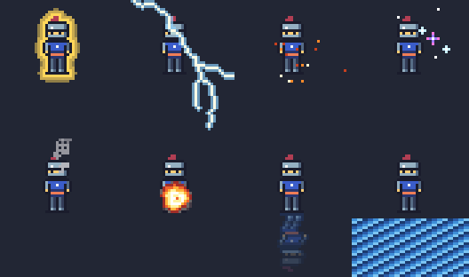

## PixelArt Studio 1.3

Effekte und Farbzyklen, vor allem für einzelne Figuren.

### Neu in 1.3

- **Effekte…** in der Werkzeugleiste: Leuchten, Blitz, Explosion, Spiegelung im Wasser, Funken, Rauch und Magie.
  Jeder Effekt liegt auf einer eigenen Ebene, läuft als Schleife über die Frames und folgt jeder Änderung an
  der Figur, genau wie Kontur und Licht. Die Vorschau im Dialog spielt ihn ab.
- **Farbzyklen** für fließendes Wasser, flackerndes Feuer und glühende Lava: Pixel einer Farbreihe wandern
  Schritt für Schritt weiter. Vorlagen für Wasser, Feuer und Lava sind dabei.
- **Aus einem Standbild eine Schleife:** fehlende Frames entstehen als Kopien, damit sich der Effekt bewegen kann.
- **Spiegelung** macht ein Bild auf Wunsch nach unten größer, damit das ganze Spiegelbild passt.
- **Claude kann das auch:** das neue Werkzeug `effects` legt Effekte an, ändert, listet und entfernt sie.

### Installieren

`pixelart-studio.exe` herunterladen und starten, eine Installation ist nicht nötig. Mit `--mcp` läuft
dieselbe Datei als MCP-Server; die Einrichtung steht im Editor unter **Datei › Einstellungen › Claude verbinden**.
Damit Claude das neue Werkzeug sieht, nach dem Austauschen der exe Claude einmal neu starten.
