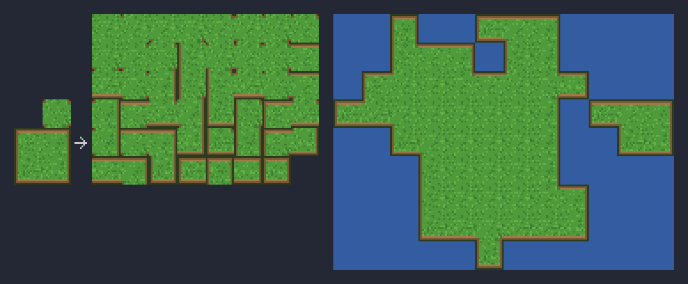

## PixelArt Studio 1.4

Kacheln und Autotile: fünf Kacheln malen, einen ganzen Satz bekommen.

### Neu in 1.4

- **Kachel-Modus** (Menü Ansicht oder Taste T): Die Leinwand zeigt das Bild 3 × 3 Mal, und was du über den
  Rand malst, kommt auf der anderen Seite wieder herein. So werden Böden und Wasser nahtlos.
- **Autotile…** im Menü Bearbeiten und im Rechtsklick-Menü: Der Dialog legt eine Vorlage an, in die du einen
  Block aus 2 × 2 Kacheln und eine Kachel mit Innenecken malst. Daraus baut er alle Kacheln mit Ecken, Rändern
  und Innenecken, wahlweise 47 (Ecken und Seiten) oder 16 (nur Seiten). Die Vorschau zeigt gleich eine Insel damit.
- **Animierte Kacheln:** Hat die Vorlage mehrere Frames, wird der ganze Satz animiert.
- **Export für Godot 4 und Tiled:** PNG plus `.tres` mit Terrain beziehungsweise `.tsx` mit Wang-Set. In Godot
  malst du danach im Reiter Terrains, in Tiled mit dem Terrain-Pinsel, und die Ränder setzen sich von selbst.
- **Claude kann das auch:** das neue Werkzeug `autotile` legt Vorlagen an, baut Sätze und zeigt sie,
  und `export` schreibt mit den Formaten `godot` und `tiled` die Dateien für die Engine.

### Installieren

`pixelart-studio.exe` herunterladen und starten, eine Installation ist nicht nötig. Mit `--mcp` läuft
dieselbe Datei als MCP-Server; die Einrichtung steht im Editor unter **Datei › Einstellungen › Claude verbinden**.
Damit Claude das neue Werkzeug sieht, nach dem Austauschen der exe Claude einmal neu starten.
