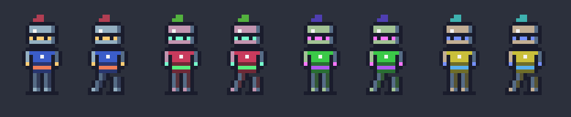

## PixelArt Studio 1.5

Drehen ohne Pixelbrei und Farbvarianten für Figuren.

### Neu in 1.5

- **Drehen…** im Menü Bearbeiten und im Rechtsklick-Menü: Dreht in jedem Winkel mit dem RotSprite-Verfahren.
  Es entstehen keine neuen Farben, Linien bleiben geschlossen, und gesperrte Paletten passen weiter. Den
  Drehpunkt setzt ein Klick in die Vorschau, und Bilder können dabei größer werden, damit nichts abgeschnitten wird.
- **Drehung im Kreis:** Über die Frames verteilt dreht sich etwas Frame für Frame weiter, mit 360° einmal
  nahtlos herum, etwa eine geworfene Axt oder eine Münze.
- **Farbvarianten…** für Figuren und ihre Animationen: rote und blaue Teams, Gold- oder Eis-Versionen. Eine
  Variante tauscht Farben und gilt für alle Animationen, gezeichnet wird nur einmal. Mit **Farbton drehen**
  entsteht eine Variante in Sekunden.
- **Export mit Variante:** Im Export-Dialog wählst du die Variante oder „Alle Varianten“, die Dateien tragen
  ihren Namen.
- **Bilder in den Release-Notizen** öffnen sich jetzt auch, obwohl das Repository privat ist.
- **Claude kann das auch:** die neuen Werkzeuge `rotate` und `variants`, und `export` nimmt `variant`.

### Installieren

`pixelart-studio.exe` herunterladen und starten, eine Installation ist nicht nötig. Mit `--mcp` läuft
dieselbe Datei als MCP-Server; die Einrichtung steht im Editor unter **Datei › Einstellungen › Claude verbinden**.
Damit Claude die neuen Werkzeuge sieht, nach dem Austauschen der exe Claude einmal neu starten.
